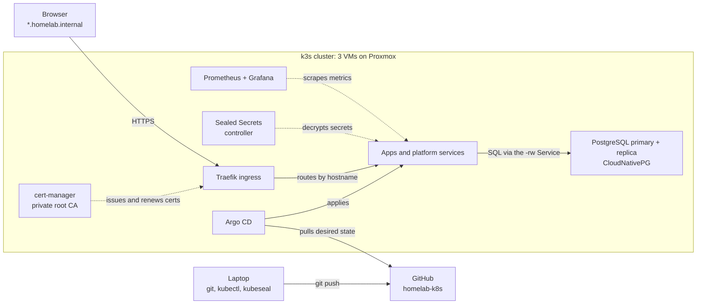

# homelab-k8s

A Kubernetes platform on my home server, run entirely through **GitOps** with the same open-source tools used in production. Every workload, certificate and (encrypted) secret in the cluster is declared in this repository, and Argo CD keeps the cluster in sync with it.

I am building this to learn the platform side properly: how applications get deployed, secured, observed and recovered, not only how they're written. It will also host the workloads for my master's thesis.

## At a glance

| Area | What's used |
|---|---|
| **Cluster** | 3-node k3s (v1.36) on Debian 13 VMs, built from a cloud-init template on Proxmox VE |
| **GitOps** | Argo CD with the app-of-apps pattern; automated sync with prune, self-heal and retry |
| **Ingress & TLS** | Traefik ingress + cert-manager with a private root CA: every app is served over trusted HTTPS |
| **Secrets** | Sealed Secrets: secrets are encrypted before they're committed, so they're safe in a public repo |
| **Observability** | Prometheus + Grafana (kube-prometheus-stack), trimmed to fit k3s and a small cluster |
| **Data** | PostgreSQL run by the CloudNativePG operator: a primary and a streaming replica on different nodes, with automatic failover |
| **Resilience** | Replicas spread across nodes, disruption budgets for planned maintenance, an N-1 capacity check, and drain and power-off drills |
| **Workflow** | Every change is a commit, validated with a server-side dry run, then applied by Argo CD. No manual `kubectl apply`. |

## Architecture



### How a change reaches the cluster
1. **Bootstrap, once per cluster:** Helm installs Argo CD, and a single `root` Application is applied by hand.
2. **`root` watches `apps/`.** Each file there is an Argo CD Application. Adding a file deploys an app; deleting it removes the app and everything it created.
3. **Each Application points at a pinned Helm chart or a folder in `manifests/`.**
4. **Argo CD keeps the cluster matching Git.** Manual changes are reverted (self-heal), resources removed from Git are deleted (prune), and failed syncs retry with backoff and move on to newer commits.
5. **Upgrades go through pull requests.** Argo CD only follows `main`, so a change on a branch deploys nothing. Merging the reviewed PR is the deploy step, and the PR is the record of why it happened.

## What's running

| App | Purpose | Source |
|---|---|---|
| `hello` | Demo app: page content from a ConfigMap, readiness probe, resource requests/limits, HTTPS ingress, a sealed secret consumed as an environment variable, and a topology spread rule that keeps its 4 replicas balanced across nodes | `manifests/hello` |
| `sealed-secrets` | Decrypts SealedSecrets inside the cluster | Helm chart `2.20.0` |
| `cert-manager` | Issues and automatically renews TLS certificates | Helm chart `v1.21.2` |
| `cert-manager-config` | Private root CA and the ClusterIssuers that sign app certificates | `manifests/cert-manager-config` |
| `monitoring` | Two Prometheus replicas on different nodes, each with its own volume and 3-day retention, behind a sticky Service so Grafana always reads the same copy; a disruption budget keeps one up during maintenance. Grafana over HTTPS with node and pod dashboards. Scrapes every ServiceMonitor in the cluster, so new apps are picked up automatically. | Helm chart `kube-prometheus-stack 92.9.0` |
| `monitoring-config` | Grafana admin credentials as a SealedSecret | `manifests/monitoring-config` |
| `glance` | The homelab start page: links to every service, plus live status checks of the cluster services over cluster DNS. Its config is a Kustomize-generated ConfigMap with a content hash in its name, so every config change is a visible, revertable rollout. | `manifests/glance` |
| `cnpg-operator` | The CloudNativePG operator: runs PostgreSQL clusters, handles replication, failover and credentials. Two replicas on different nodes with leader election, so a node loss can't take out the database and the thing that fails it over at once. | Helm chart `0.29.0` (operator 1.30) |
| `nextcloud-config` | Nextcloud's backing services: a 2-instance PostgreSQL 17 cluster, a Valkey cache (Redis-compatible, used for file locking), and the admin and cache passwords as SealedSecrets | `manifests/nextcloud-config` |
| `nextcloud` | Nextcloud 35 file sync behind Traefik, using the external database and cache. A startup probe protects the first install and every upgrade from being killed halfway, and a cron sidecar runs background jobs. | Helm chart `9.4.1` |
| `traefik-config` | Two Traefik replicas spread across nodes, with a disruption budget. Traefik is installed by k3s itself; this overrides its chart values through k3s's `HelmChartConfig`, so even a component Argo CD didn't install is configured from Git. | `manifests/traefik-config` |
| Argo CD | The GitOps controller itself, bootstrapped with Helm | `bootstrap/argocd-values.yaml` |

## Repository layout

```
apps/          Argo CD Applications, one file per app (watched by root)
bootstrap/     Argo CD Helm values and the root Application (applied once by hand)
manifests/     Kubernetes manifests, one folder per app
pub-cert.pem   Sealed Secrets public certificate (public by design: it can only encrypt)
scripts/       Tools run by hand, such as the N-1 capacity check (not watched by Argo CD)
docs/          Design decisions and lessons learned
```

## Security

- **No plaintext secrets in Git.** Secrets are encrypted with `kubeseal` against the cluster's public key. Only the controller in the cluster holds the private key, and each encrypted value is bound to its name and namespace.
- **Private keys stay private.** The Sealed Secrets key backup and the root CA key never enter this repository; `.gitignore` guards against accidents.
- **Admin passwords are generated, not typed,** so they never end up in shell history.
- **Database passwords never leave the cluster.** The PostgreSQL operator generates them into a Secret that Nextcloud reads directly; they don't exist on my laptop or in Git.
- **Nothing is exposed to the internet.** Hostnames under `homelab.internal` only resolve on my own machines. The private IP addresses in this repo can't be reached from outside my network.

## Failure drills

Things I broke on purpose, and what happened.

| Drill | What happened | Takeaway |
|---|---|---|
| Drain a node, then uncordon it | Its pods were evicted and restarted on the other nodes. After the uncordon, none of them moved back. | Placement is decided once, at scheduling time |
| Power off an agent | Prometheus saw failed scrapes (`up == 0`) before Kubernetes marked the node `NotReady`; pods were evicted after 5 minutes | Two independent signals for one failure; `up == 0` is the classic first alert |
| Close Prometheus's node and delete its pod | The replacement stayed `Pending`: volume node affinity conflict | A local volume pins its pod to one node (lessons-learned #6) |
| Delete the PostgreSQL primary pod | The replica was promoted within seconds and the `-rw` Service followed it. No data lost; the old primary came back as a replica. | Replication in the application, not the storage, is what survives here |
| Upgrade Nextcloud through a pull request | Nothing deployed until the merge. On start, the new image ran Nextcloud's own upgrade, covered by the startup probe. | The merge is the deploy gate. Nextcloud upgrades are one-way, so they're deliberate. |
| Roll out with a strict spread rule while a node is cordoned | The new pods stayed `Pending`: the cordoned node still counted as a spread domain with zero pods, so no other node could take more than one | Strict spreading needs `nodeTaintsPolicy: Honor`, or every deploy hangs during maintenance |
| Drain the node running the PostgreSQL primary | The disruption budget refused to evict the primary until the operator had switched over to the replica; then the drain finished | Budgets plus an operator that hands over the primary make maintenance safe (the first attempt waited forever: lessons-learned #9) |
| Start a second drain while the first node is still out | Refused: the only running database instance is protected by its budget | Budgets stop overlapping maintenance from taking everything down at once |
| Power off an agent, with written predictions | After the node went `NotReady`, Deployment pods were replaced elsewhere 300 seconds after the eviction taint. Nextcloud waited for its node (its volume is there), and StatefulSet pods hung in `Terminating` until the `out-of-service` taint. The database failed over late: its operator had died on the same node (lessons-learned #10). | Detection time is downtime, and whatever handles failures must not share a failure domain with what it protects |

## Lessons learned

Write-ups of real problems hit while building this, each with symptom, root cause, fix and prevention: **[docs/lessons-learned.md](docs/lessons-learned.md)**. A few highlights:

- After a dual-boot, the server's clock started three hours ahead. k3s issued certificates "from the future", and once the clock corrected itself, the API server stopped working.
- One invalid manifest blocked every sync of an app, because Argo CD runs one sync operation at a time per application.
- A field indented one level too deep was silently dropped by the API server: every sync reported success, yet the app never stopped being out of sync.
- With its node closed, Prometheus couldn't start anywhere else, despite two nodes with free capacity: its volume is a folder on that node's disk. That's why the next phases replicate stateful apps at the application level.
- In a power-off drill, the database lost its primary and nobody promoted the replica for several minutes: the operator responsible for failover was running on the node that died.

The reasoning behind each tool and trade-off: **[docs/decisions.md](docs/decisions.md)**.

## Roadmap

- [x] 3-node k3s cluster on Proxmox: cloud-init template, scheduling, drain and node-failure drills
- [x] GitOps with Argo CD (app-of-apps) and Sealed Secrets
- [x] cert-manager with a private root CA; HTTPS ingress for every app
- [x] Monitoring with Prometheus and Grafana, including a node-failure drill seen through the metrics
- [x] Glance dashboard as the homelab start page
- [x] Nextcloud on CloudNativePG (PostgreSQL operator, primary plus replica) and Valkey, with a database failover drill and a version upgrade through a pull request
- [x] Resilience: replicated Prometheus, Traefik and the database operator, PodDisruptionBudgets, topology spread, an N-1 capacity check, maintenance and power-loss drills
- [ ] Backups and disaster recovery: PostgreSQL point-in-time recovery from off-site object storage, Nextcloud files, and a full rebuild from Git plus backups
- [ ] The trading platform from my bachelor's thesis (.NET, Go, Python, React; RabbitMQ, Redis, PostgreSQL), with images built by GitHub Actions and pushed to ghcr.io
- [ ] Master's thesis: Go vs Rust service performance, measured on identical infrastructure

## Bootstrap

Prerequisites: a running k3s cluster, `kubectl` and Helm.

```bash
helm repo add argo https://argoproj.github.io/argo-helm
helm install argocd argo/argo-cd -n argocd --create-namespace \
  --version 10.10.5 -f bootstrap/argocd-values.yaml
kubectl apply -f bootstrap/root.yaml
```

Argo CD then deploys everything under `apps/`. **On a rebuilt cluster,** restore the Sealed Secrets key backup before the controller starts, or the SealedSecrets already in this repo can't be decrypted.