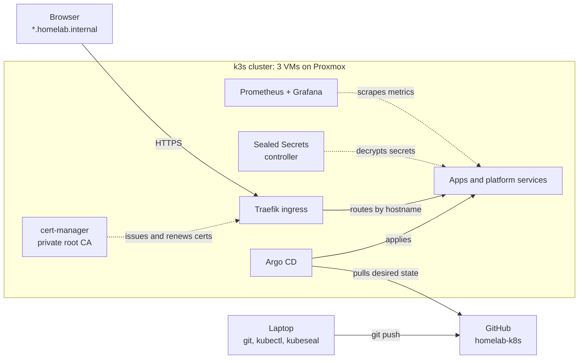

# homelab-k8s

A Kubernetes platform on my home server, run entirely through **GitOps** with the same open-source tools used in production. Every workload, certificate and (encrypted) secret in the cluster is declared in this repository, and Argo CD keeps the cluster in sync with it.

I am building this to learn the platform side properly: how applications get deployed, secured, observed and recovered, not only how they're written. It will also host the workloads for my master's thesis.

## At a glance

| Area | What's used |
|---|---|
| **Cluster** | 3-node k3s (v1.36) on Debian 13 VMs, built from a cloud-init template on Proxmox VE |
| **GitOps** | Argo CD with the app-of-apps pattern; automated sync with prune, self-heal and retry |
| **Ingress & TLS** | Traefik ingress + cert-manager with a private root CA: every app is served over trusted HTTPS |
| **Secrets** | Sealed Secrets: secrets are encrypted before they're committed, so they're safe in a public repo |
| **Observability** | Prometheus + Grafana (kube-prometheus-stack), trimmed to fit k3s and a small cluster |
| **Workflow** | Every change is a commit, validated with a server-side dry run, then applied by Argo CD. No manual `kubectl apply`. |

## Architecture



### How a change reaches the cluster
1. **Bootstrap, once per cluster:** Helm installs Argo CD, and a single `root` Application is applied by hand.
2. **`root` watches `apps/`.** Each file there is an Argo CD Application. Adding a file deploys an app; deleting it removes the app and everything it created.
3. **Each Application points at a pinned Helm chart or a folder in `manifests/`.**
4. **Argo CD keeps the cluster matching Git.** Manual changes are reverted (self-heal), resources removed from Git are deleted (prune), and failed syncs retry with backoff and move on to newer commits.

## What's running

| App | Purpose | Source |
|---|---|---|
| `hello` | Demo app: page content from a ConfigMap, readiness probe, resource requests/limits, HTTPS ingress, and a sealed secret consumed as an environment variable | `manifests/hello` |
| `sealed-secrets` | Decrypts SealedSecrets inside the cluster | Helm chart `2.20.0` |
| `cert-manager` | Issues and automatically renews TLS certificates | Helm chart `v1.21.2` |
| `cert-manager-config` | Private root CA and the ClusterIssuers that sign app certificates | `manifests/cert-manager-config` |
| `monitoring` | Prometheus (3-day retention, persistent volume) and Grafana over HTTPS, with node and pod dashboards. Scrapes every ServiceMonitor in the cluster, so new apps are picked up automatically. | Helm chart `kube-prometheus-stack 92.9.0` |
| `monitoring-config` | Grafana admin credentials as a SealedSecret | `manifests/monitoring-config` |
| `glance` | The homelab start page: links to every service and live status checks over cluster DNS. Its config is a Kustomize-generated ConfigMap with a content hash in its name, so every config change is a visible, revertable rollout. | `manifests/glance` |
| Argo CD | The GitOps controller itself, bootstrapped with Helm | `bootstrap/argocd-values.yaml` |

## Repository layout

```
apps/          Argo CD Applications, one file per app (watched by root)
bootstrap/     Argo CD Helm values and the root Application (applied once by hand)
manifests/     Kubernetes manifests, one folder per app
pub-cert.pem   Sealed Secrets public certificate (public by design: it can only encrypt)
docs/          Design decisions and lessons learned
```

## Security

- **No plaintext secrets in Git.** Secrets are encrypted with `kubeseal` against the cluster's public key. Only the controller in the cluster holds the private key, and each encrypted value is bound to its name and namespace.
- **Private keys stay private.** The Sealed Secrets key backup and the root CA key never enter this repository; `.gitignore` guards against accidents.
- **Admin passwords are generated, not typed,** so they never end up in shell history.
- **Nothing is exposed to the internet.** Hostnames under `homelab.internal` only resolve on my own machines. The private IP addresses in this repo can't be reached from outside my network.

## Lessons learned

Write-ups of real problems hit while building this, each with symptom, root cause, fix and prevention: **[docs/lessons-learned.md](docs/lessons-learned.md)**. A few highlights:

- After a dual-boot, the server's clock started three hours ahead. k3s issued certificates "from the future", and once the clock corrected itself, the API server stopped working.
- One invalid manifest blocked every sync of an app, because Argo CD runs one sync operation at a time per application.
- A field indented one level too deep was silently dropped by the API server: every sync reported success, yet the app never stopped being out of sync.
- With its node closed, Prometheus couldn't start anywhere else, despite two nodes with free capacity: its volume is a folder on that node's disk. That's why the next phases replicate stateful apps at the application level.

The reasoning behind each tool and trade-off: **[docs/decisions.md](docs/decisions.md)**.

## Roadmap

- [x] 3-node k3s cluster on Proxmox: cloud-init template, scheduling, drain and node-failure drills
- [x] GitOps with Argo CD (app-of-apps) and Sealed Secrets
- [x] cert-manager with a private root CA; HTTPS ingress for every app
- [x] Monitoring with Prometheus and Grafana, including a node-failure drill seen through the metrics
- [x] Glance dashboard as the homelab start page
- [ ] Nextcloud on CloudNativePG (PostgreSQL operator, primary plus replica) and Valkey, with a database failover drill and a version upgrade through a pull request
- [ ] Resilience: replicated Prometheus, PodDisruptionBudgets, topology spread, an N-1 capacity check and backups off the physical host
- [ ] The trading platform from my bachelor's thesis (.NET, Go, Python, React; RabbitMQ, Redis, PostgreSQL), with images built by GitHub Actions and pushed to ghcr.io
- [ ] Master's thesis: Go vs Rust service performance, measured on identical infrastructure

## Bootstrap

Prerequisites: a running k3s cluster, `kubectl` and Helm.

```bash
helm repo add argo https://argoproj.github.io/argo-helm
helm install argocd argo/argo-cd -n argocd --create-namespace \
  --version 10.10.5 -f bootstrap/argocd-values.yaml
kubectl apply -f bootstrap/root.yaml
```

Argo CD then deploys everything under `apps/`. **On a rebuilt cluster,** restore the Sealed Secrets key backup before the controller starts, or the SealedSecrets already in this repo can't be decrypted.